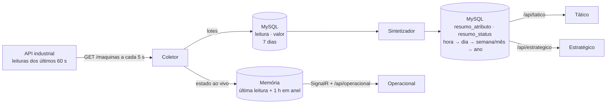

# Arquitetura

O sistema é um **pipeline de dados**: cada etapa recebe os dados num formato e entrega em outro. A filosofia de programação é o **Data Oriented Design (DOD)**: antes de pensar em classes, pensa-se em *quais dados existem, em que formato e quem os transforma*.

| Peça | Tecnologia | Onde |
|---|---|---|
| Coletor, sintetizador e API | C# / .NET 10, ASP.NET Core (Minimal API + SignalR) | `backend/Pi3.Backend` |
| Banco | MySQL 8.4 com SQL explícito via `MySqlConnector`, sem ORM | `database/` |
| Telas | Angular 22 + TypeScript, gráficos com ECharts | `frontend/` |
| Simulador da API (só testes) | C# / .NET 10 | `backend/Pi3.Simulador` |

Um único processo .NET roda o coletor, o sintetizador e a API, e serve as telas já compiladas. Na apresentação basta um comando (veja [como-rodar.md](como-rodar.md)).

## Como o DOD aparece no código

1. **Dados separados do comportamento.**
   - `Dados/` só tem estruturas de dados, sem lógica.
   - `Transformacoes/` só tem funções estáticas que recebem dados e devolvem dados.
   - `Sistemas/` tem os laços que chamam as transformações em ordem.
   - Não há hierarquias de classes, repositórios genéricos nem objetos "inteligentes".

2. **Colunas em vez de objetos (struct of arrays).**
   - Uma coleta vira um `Lote`: um array para os instantes, um para as máquinas, um para os valores…, alinhados pela posição.
   - Os resumos (`ColunasResumo`) seguem o mesmo formato, e a API também responde em colunas: `instantes: [...]`, `series: { temperatura: [...] }`. É o formato que os gráficos consomem direto.

3. **Ids pequenos e densos viram índices.**
   - Os cadastros (máquina, atributo, status) são carregados em memória como arrays indexados pelo id (`Dados/Dimensoes.cs`).
   - Os acumuladores da síntese são arrays planos indexados por `máquina × nº de atributos + atributo`: sem dicionários e sem busca.

4. **Formato físico escolhido pelo uso.**
   - As tabelas de fatos têm chave primária começando pelo **tempo**: `(instante, maquina_id, atributo_id)`.
   - O InnoDB guarda as linhas nessa ordem. Inserir é sempre no fim, e tanto a síntese quanto a limpeza leem faixas de tempo contínuas.

5. **Uma forma só para todos os níveis de resumo.**
   - Hora, dia, semana, mês e ano usam a mesma estrutura de campos somáveis: n, soma, soma², mín, máx, primeiro, último, incremento.
   - Por isso **a mesma função** (`Sintese.DeResumos`) calcula qualquer nível a partir do nível abaixo, sempre de forma exata.

6. **Processamento em lote.** O coletor grava cada coleta numa transação com INSERTs de várias linhas. O sintetizador processa um período inteiro de uma vez, numa passada linear sobre dados já ordenados.

7. **Cada tela lê o dado já pronto para ela.** O operacional lê da memória; o tático e o estratégico leem resumos. Nenhuma tela agrega leituras brutas.

## O caminho de uma leitura

| Etapa | O que acontece | Arquivo |
|---|---|---|
| 1. Buscar | `GET {ApiUrl}/maquinas` a cada 5 s | `Sistemas/Coletor.cs` |
| 2. Decodificar | JSON → `LoteRecebido` (colunas, códigos em texto) | `Transformacoes/Decodificacao.cs` |
| 3. Cadastrar | Códigos novos viram cadastros; os cadastros em memória são trocados inteiros | `Persistencia/Banco.cs` |
| 4. Derivar | Códigos → ids, descarte de repetidas, duração, incrementos, marcas de qualidade | `Transformacoes/Derivacao.cs` |
| 5. Estado ao vivo | Atualiza status e último valor, e acrescenta ao histórico em anel | `Dados/EstadoAoVivo.cs` |
| 6. Gravar | `leitura` + `valor` numa transação; com o banco fora do ar, o lote espera numa fila | `Persistencia/BancoLeituras.cs` |
| 7. Publicar | Evento `leituras` no SignalR para as telas abertas | `Endpoints/Mensagens.cs` |
| 8. Sintetizar (a cada 60 s) | Brutos → hora → dia → semana/mês → ano, e depois a retenção | `Sistemas/Sintetizador.cs` |

## Disponibilidade, a prioridade do operacional

- **O operacional não depende do banco.** A última leitura e a última hora de cada máquina ficam em memória (`EstadoAoVivo`).
- **Se o banco cair**, a coleta continua: os lotes esperam numa fila de até ~1 hora (`Coletor.MaxPendentes`) e são gravados quando o banco voltar.
- **Se o canal ao vivo (SignalR) cair**, a tela passa a consultar `/api/operacional/agora` a cada 5 s até reconectar.
- **Se o backend reiniciar**, ele retoma o estado a partir do que está no banco. A API guarda 60 s de leituras, então uma parada curta não perde nada.

## Rotas da API

| Nível | Rota | Devolve |
|---|---|---|
| — | `GET /api/saude` | Situação da coleta, do banco e da síntese |
| — | `GET /api/dimensoes` | Máquinas, tipos, atributos (nome, unidade, natureza) e status |
| Operacional | `GET /api/operacional/agora` | Última leitura e status de cada máquina |
| Operacional | `GET /api/operacional/maquinas/{codigo}/serie?minutos=60` | Histórico da janela em colunas |
| Operacional | SignalR `/hubs/operacional`, evento `leituras` | Leituras novas a cada coleta |
| Tático | `GET /api/tatico/indicadores?granularidade=semana\|mes&periodos=8&agrupar=maquina\|planta&maquina=` | Indicadores por período |
| Estratégico | `GET /api/estrategico/indicadores?granularidade=mes\|ano&periodos=12&agrupar=planta\|tipo` | Indicadores por período |

Cada nível só aceita as granularidades que lhe cabem. O tático recusa `ano`; quanto mais alto na pirâmide, mais resumido o dado. Os indicadores estão definidos em [tratativas-de-dados.md](tratativas-de-dados.md#definição-dos-indicadores).

## Telas (Angular)

As três áreas ficam separadas por nível e são carregadas sob demanda (lazy loading). O código do estratégico só é baixado por quem abre o estratégico.

Para abrir o painel é preciso entrar com um perfil, e cada perfil vê só os seus níveis: o operador vê o operacional; o tático, o operacional e o tático; o estratégico, todos. É um protótipo só no frontend, sem verificação no backend. As contas e as limitações estão em [usuarios.md](usuarios.md).

| Área | Rota | Público | Conteúdo |
|---|---|---|---|
| Login | `/login` | Todos | Usuário e senha; o perfil define os níveis liberados |
| Operacional | `/operacional` | Quem acompanha a máquina | Cartão por máquina: status, valores ao vivo, idade da leitura |
| Operacional | `/operacional/:maquina` | Quem acompanha a máquina | Faixa de status e um gráfico por atributo (15, 30 ou 60 min) |
| Tático | `/tatico` | Supervisão e gerência | Semanal ou mensal: produção, perdas, disponibilidade, desgaste por máquina |
| Estratégico | `/estrategico` | Diretoria | Mensal ou anual: indicadores da planta, tendência e comparação por tipo |

Gráficos:
- **Cores das máquinas:** vêm de uma paleta validada para daltonismo e seguem a máquina, nunca a posição na tela.
- **Status:** sempre mostrados com cor + ícone + texto.
- **Escalas:** nenhum gráfico tem dois eixos verticais; medidas diferentes ficam em gráficos separados.
- **Tabela equivalente:** toda tela com gráfico também tem os mesmos dados em tabela.

## Configuração (`backend/Pi3.Backend/appsettings.json`, seção `Pi3`)

| Chave | Padrão | Para quê |
|---|---|---|
| `ApiUrl` | `http://10.82.175.92:8080` | Endereço da API industrial. O IP muda: ajuste aqui |
| `ColetaIntervaloSegundos` | 5 | Intervalo entre consultas à API |
| `LimiteLacunaSegundos` | 60 | Continuidade entre leituras (T05) |
| `SinteseIntervaloSegundos` | 60 | Ciclo do sintetizador |
| `SinteseCarenciaSegundos` | 120 | Espera antes de fechar uma hora |
| `RetencaoBrutoHoras` | 168 | Tempo que as leituras brutas ficam no banco |
| `RetencaoHoraDias` | 90 | Tempo que os resumos por hora ficam no banco |
| `FusoMinutos` | −180 | Fuso dos limites de período (Brasília) |
| `MinutosAoVivo` | 60 | Tamanho do histórico em memória |
| `PastaFrontend` | `../../frontend/dist/painel/browser` | Telas compiladas servidas pelo backend |

O perfil `demo` (`appsettings.Demo.json`) encurta os ciclos para mostrar a síntese durante a apresentação.
