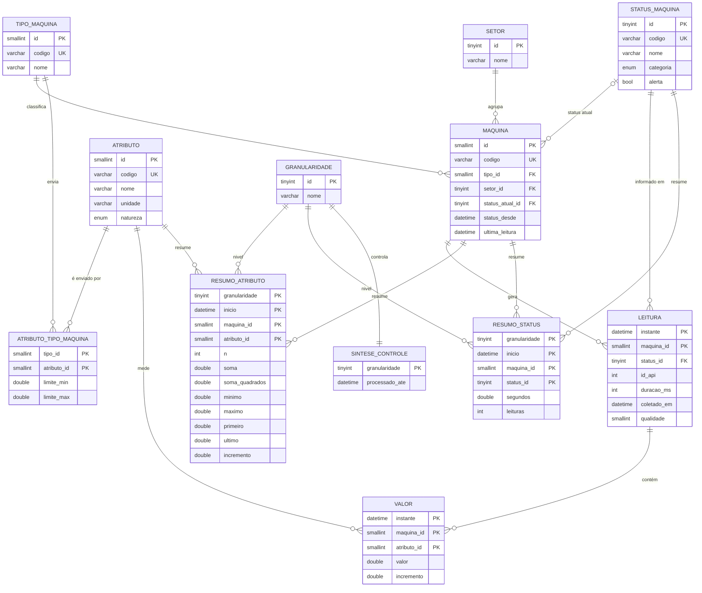

# Modelo de dados

Modelo físico implementado em [`database/02_schema.sql`](../database/02_schema.sql). Ele parte do DER original da equipe; as mudanças estão descritas logo abaixo do diagrama.



## O que mudou em relação ao DER original

| DER original | Modelo novo | Motivo |
|---|---|---|
| `Atributo_Valor` ligado direto à `Maquina` | `leitura` (uma por envio da API) + `valor` (um por atributo da leitura) | Sem a leitura não dá para saber quais valores chegaram juntos, nem o horário e o status de cada envio. |
| `Status_Maquina` só como status atual da máquina | Mantido como status atual (`maquina.status_atual_id`) **e** gravado em cada leitura; ganhou `categoria` e `alerta` | O status muda com o tempo e o tempo em cada status é a base da disponibilidade. `categoria` agrupa os códigos da API nos três estados do negócio (T07). |
| `Historico_Maquina` e `Relatorio_Semanal_Maquina` | Uma família de resumos com a mesma estrutura: `resumo_atributo` e `resumo_status`, nas granularidades hora, dia, semana, mês e ano | Mesmo papel (guardar o longo prazo para os níveis altos) com uma regra só. O mês não sai do semanal, porque as semanas cruzam meses; por isso semana e mês saem do dia. |
| Cardinalidades mínimas `(1,n)` em Relatório, Histórico, Status, Setor e Tipo | `(0,n)` | Uma máquina recém-cadastrada ainda não tem histórico nem relatório; um setor ou status pode existir sem máquinas. |
| `Atributo` só com nome | Ganhou `unidade` e `natureza` (MEDIDA ou CONTADOR) | Contadores são resumidos pela variação, não pela média (T06). |
| `Atributo_Tipo_Maquina` | Mantida, com `limite_min` e `limite_max` | Diz quais atributos cada tipo envia e já reserva o lugar dos limites operacionais. |
| — | `granularidade` e `sintese_controle` | Controle de até onde cada nível já foi fechado, para a retenção apagar só o que já foi resumido. |

## Dicionário das tabelas

| Tabela | Uma linha é… | Chave | Volume esperado |
|---|---|---|---|
| `setor` | um setor da planta (hoje só "Setor1") | `id` | poucas |
| `tipo_maquina` | um tipo (campo `tipo` da API) | `id`, `codigo` único | poucas |
| `maquina` | uma máquina (campo `maquina` da API) | `id`, `codigo` único | poucas |
| `atributo` | um campo numérico da API | `id`, `codigo` único | ~16 |
| `status_maquina` | um código de status | `id`, `codigo` único | ~8 |
| `atributo_tipo_maquina` | "o tipo X envia o atributo Y" | (tipo, atributo) | dezenas |
| `leitura` | um envio de uma máquina | (instante, máquina) | ~17 mil por máquina por dia; guardado 7 dias |
| `valor` | um atributo numérico de uma leitura | (instante, máquina, atributo) | ~6 por leitura; guardado 7 dias |
| `resumo_atributo` | resumo de um atributo de uma máquina num período | (granularidade, início, máquina, atributo) | horas: 90 dias; o resto para sempre |
| `resumo_status` | tempo de uma máquina num status num período | (granularidade, início, máquina, status) | idem |
| `sintese_controle` | até onde cada granularidade foi fechada | granularidade | 5 |

### Como ler um resumo

| Para obter | Use |
|---|---|
| Média | `soma / n` |
| Desvio padrão | `sqrt((soma_quadrados − soma²/n) / (n − 1))` |
| Produção, defeitos etc. no período (contadores) | `incremento` |
| Valor no início e no fim do período | `primeiro` / `ultimo` |
| Horas em cada status | `resumo_status.segundos / 3600` |

Os limites de período estão em UTC. Exemplo: o dia 10/11 no horário de Brasília começa em `2026-11-10 03:00:00` (T13).

```sql
-- Produção por dia de cada máquina
SELECT DATE(r.inicio - INTERVAL 3 HOUR) AS dia, m.codigo, r.incremento AS producao
  FROM resumo_atributo r
  JOIN maquina m ON m.id = r.maquina_id
  JOIN atributo a ON a.id = r.atributo_id
 WHERE r.granularidade = 2 AND a.codigo = 'producao'
 ORDER BY dia, m.codigo;
```
